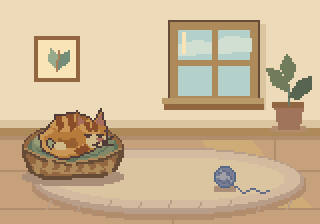

# Marmalade's little morning



An original ginger tabby wakes in a sage-cushioned basket, rolls onto the rug,
stretches, taps a blue yarn ball and pounces after it. A playful flop becomes one
last tap, then Marmalade returns to the warm spot. All cat anatomy, room geometry,
basket, yarn and pose keys were drawn for this scene. No earlier character art,
form template or image trace is imported.

The native scene is 160×112 pixels. Its `little_morning` tag has 80 exact 100 ms
poses, an 8000 ms loop and pivot `(0,0)`. The full room intentionally fills the
canvas. Marmalade's body and head span about 35 pixels; its long curved tail adds
another expressive silhouette. The player can display the scene at 4×, while the
complete exported-atlas GIF uses 2× to keep all 80 decoded poses and their full
contact sheet within the proof tool's 64 million pixel work budget.

## Build and inspect

From the repository root:

```powershell
node examples/cozy-cat/build.mjs
node examples/cozy-cat/check.mjs
```

The driver resolves this checkout's matching external managed runtime and invokes
its absolute `scripts/run-managed.js` launcher. An isolated build and offline
proofs leave existing editing sessions untouched. Generated build output is in
ignored `dist/`; each review gets a new ignored `.reviews/review-*` directory and
earlier reviews are preserved. Machine-local results use ignored `.raw-*.json`
files. Rebuilds replace this example's generated assets. Keep manual variants
outside the generated directories.

Review `all-source-1x.png` and all twenty `poses-*-4x.png` cards in the latest
private review directory. Every card contains four consecutive source poses at
4×, with no omitted cells. Inspect the actual `scene.gif`, its full contact sheet
and all eighty decoded PNG frames. Pause around the first tap, pounce landing,
flop, return to bed and last-to-first seam.

## Pose and scene source

- `timeline.mjs` declares the eighty story poses, ball positions, authored turns,
  expressions, foot targets and five visitor-facing story cues.
- `art.mjs` defines named reusable cat anatomy, fur clusters, cream paws, muzzle,
  ears, tabby stripes, tail, basket, cushion, room and yarn geometry.
- `contour.mjs` compiles editable polyline edges around the original cat parts,
  using the shared primitive raster rules. The underlying part polygons and
  surfaces remain independently editable.
- `generate.mjs` composes each scene pose, enables retained lighting, assigns its
  exact hold and name, and creates the looping tag and scene pivot.
- `sprite-project.json` declares every art/build helper and shared raster input,
  normal export and bounded replay for the first source cell.

The first eight frames hold the sleepy curl. Frames 8–11 wake; 12–21 tumble from
the basket; 22–27 stretch; 28–39 stalk and tap; 40–49 pounce and flop; 50–55 return
the yarn; 56–73 head home and curl in; 74–79 settle. The final source image is
pixel-identical to the first. The ball starts moving at the cream paw's first tap
and remains still during the airborne approach until the pounce landing meets it.
The rolling cat uses tucked paws and a rotating head/ears/body with a curved tail,
so the roll is visible in its shape rather than only through translation.

## Enhanced tools and receipts

Named reusable composition parts retain the editable fur and cushion dome
normals, yarn dome, basket/window bevels and material flags. A lamp attached to
the window contributes warm morning light; explicit RGB ambient/sky lighting is
enabled on all eighty source cells. Deliberate flat color clusters keep the room
quiet and the cat readable. Cat outlines stay dark aubergine brown. Source colors
and surfaces remain editable; the normal atlas is not a baked color effect.

The color and normal sheets use identical packing, offsets, aliases, durations,
tag ranges and pivot, with exact matching alpha. Normal axes are +X right,
exported green up and +Z toward the viewer. The first cell's construction replay
records actual compose, lighting and naming operations with source hashes.

`site/assets/cozy-cat/` contains `sheet.png`, `atlas.json`, `normal.png`,
`normal.atlas.json`, compact self-contained `project.json`, `replay.json`,
`manifest.json`, `scene.gif`, `poster.png`, complete `contact.png`, portable
`proof-input.json`, `proof.json` and eighty decoded images under `frames/`.
Select the tag's bounds: the atlas also contains base grid entries and static
named aliases, which do not represent additional poses.

The GIF proof uses the actual exported atlas and explicit opaque `#ecdab9` matte.
It reports decoded frame count, exact delays, loop policy, timing drift and actual
palette error. PNG/atlas source remains authoritative if an export needs GIF
quantization. Public reports relocate path strings while preserving source hashes
and decoded measurements. The manifest hashes every delivered artifact other
than itself.

Each textual `sourceInputs` record keeps captured raw `sha256` and `bytes`, plus
`normalizedTextSha256` for UTF-8 text with CRLF and lone CR converted to LF. Use
the normalized identity when a platform's Git checkout changes line endings;
retain the original raw evidence. Binary artifacts and proof inputs always use
their exact-byte identities.

`check.mjs` verifies artifact and proof input hashes, normalized source identity,
timing, paired alpha/normal metadata, dark exposed cat contours, cat clearance,
grounded support paws, declared paw/ball contacts, bounded ball motion and the
last-to-first pixel seam. These checks support the visual review; they do not
establish natural motion on their own.
