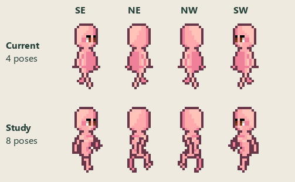

# Eight-pose adult diagonal walk



Build the editable 16×32 adult walk from the plugin root.

```sh
node scripts/run-managed.js build examples/native-character/diagonal-walk/sprite-project.json
```

Open `dist/preview.html` to play the exported tags. The build also writes the editable project, transparent sheet and atlas under `dist/`. In the [source sheet](walk.png), rows run southeast, northeast, northwest and southwest. Each row shows contact, load, passing and heel rise on one leg, then the same four phases on the other. The eight frames take 500 ms per loop.

Select `walk_front-right`, `walk_back-right`, `walk_back-left` or `walk_front-left` in the atlas. The ground pivot is (8, 29). The generator preserves the one-pixel outline and groups skin and eye colors separately for editing. The [four-frame mannequin](../README.md) also provides idle poses, cardinal walks and joint reports.
