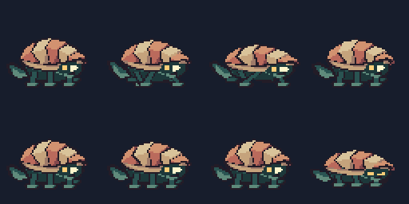

# Tessel the Foldback



An original 64×64 character made from named, editable polygons. Tessel has a low
crescent of five folded shell leaves, six soft paddles, a doubled-back ribbon
tail and a luminous face beneath its hood. Its silhouette, anatomy, palette and
pose keys were authored here. No other character, template, previous showcase
art or image trace is imported.

The source uses dark aubergine outer edges, alternating ivory and coral shell
planes, a petrol underside and restrained sea glass and amber accents. Broad
planes carry the shell's folds; small surfaces use two or three readable clusters.
The source grid is 64×64, transparent, with pivot `(32,55)`. The review draw scale
is 4×; the eight-track montage uses 2× to keep its complete proof within bounds.

## Build and review

From the repository root:

```powershell
node examples/tessel/build.mjs
node examples/tessel/check.mjs
```

The build driver resolves this checkout's matching external managed runtime and
invokes its absolute `scripts/run-managed.js` launcher. It uses an isolated build
and offline exported-atlas proofs; it never opens or mutates an editing session.
Every proof uses a new directory under ignored `.reviews/`. Earlier reviews are
preserved. Machine-local command results use ignored `.raw-*.json` names.

Canonical art inputs are `generate.mjs`, `poses.mjs` and `palette.json`, with the
editable contour compiler and build driver declared as additional hashed inputs.
The contour compiler uses the shared primitive raster rules to derive named,
editable polyline edges from the original part polygons. It paints a consistent
one-pixel aubergine edge without flattening the character or replacing its parts.
Its shared raster imports are also declared build inputs. `sprite-project.json` records
the tag contract, paired normal export and bounded construction replay. Rebuilds
replace the generated `dist/` and this example's published `site/assets/tessel/`
files. Keep manual variants outside those generated directories.

Inspect `.reviews/review-*/source-1x.png`, the sixteen `source-row-*-4x.png`
strips, each action's complete contact sheet and actual GIF. The native sheet
contains all 128 physical source cells, once each. All cells are used; none are
deliberately omitted. The published atlas includes 128 base grid entries, 128 tag
sequence entries and 128 named static aliases; consumers should select tag bounds.

## Animation contract

Each action has eight authored poses and tags `<action>_right` and
`<action>_left`. The left poses are whole-cell reflections, including retained
normals, lamps and sky direction. There is no held asymmetric equipment.

| Action | Source period | Playback | Pose design |
| --- | ---: | --- | --- |
| idle | 1600 ms | loop | Shell breath, slow ribbon flick, blink |
| scuttle | 800 ms | loop | Alternating three-foot support and lifted paddles |
| burst | 400 ms | loop | Flatter swept shell, longer stride, ribbon follow-through |
| hop | 1600 ms | once | Anticipation, stretch, tucked feet, held apex, landing squash |
| listen | 1600 ms | once | Lifted hood, expanded near eye, forward attention and release |
| bloom | 1600 ms | once | Compressed anticipation, five leaf fan, pleased eyes, settle |
| flinch | 800 ms | once | Recoil, shut eyes, compact shell, tucked ribbon, recovery |
| rest | 1600 ms | loop | Low folded shell, closed eyes, quiet breathing |

Exact cell holds live in `poses.mjs`; per-cell millisecond metadata takes precedence
over group FPS. The gait uses alternating tripods: near paddles 1 and 3 plus far
paddle 2 oppose near paddle 2 plus far paddles 1 and 3. Support phases remain on
their baseline; recovery phases raise each paddle. This is an in-place animation,
with no world-distance or engine foot-planting claim.

## Enhanced authoring tools actually used

- Reusable part composition expands stable named foot, shell, body, ribbon and
  face shapes into independently editable copies, retaining surface metadata.
- Exact millisecond holds and explicit loop metadata survive project and atlas.
- Every cell retains dome, bevel and flat normals, solid material regions and one
  attached unlit face lamp. A subtle RGB ambient/sky/face-lamp bake is enabled on
  every cell. Painted colors remain editable; the source is not pre-baked geometry.
- `normal.png` and `normal.atlas.json` use the color atlas's packing, timing,
  pivot and exact alpha. The normal convention is +X right, exported green up.
- The first source cell has four recorded construction states, including actual
  compose geometry and lighting. `replay.json` and the embedded project replay
  retain source hashes and contribution evidence.
- All eight action GIFs and the montage come from the exported atlas. The proof
  tool decodes its GIF output and checks frame count, delays, loop policy and
  pixels. Each report includes measured timing drift and palette error.

## Published files and receipts

`site/assets/tessel/` contains the color/normal sheet and atlas pairs, compact
self-contained `project.json`, `replay.json` and `manifest.json`. Each action
folder includes `scene.gif`, `poster.png`, the complete `contact.png`, its portable
`proof-input.json`, decoded PNG `frames/` and `proof.json`. The top-level montage
uses all eight actual tracks, each explicitly repeating, for a 1600 ms comparison;
individual one-shot action proofs preserve their authored playback policy.

GIFs use an explicit opaque `#171d2c` matte. Transparent PNG/atlas source remains
authoritative. Current action proofs have zero timing drift and exact decoded
pixel comparisons; this is a measured result for these exports, not a promise
that arbitrary RGB lighting remains within GIF's palette limit. Public proof
reports relocate path strings while preserving input hashes, timing and pixel
measurements. The published manifest hashes every delivered file other than itself.

Each `sourceInputs` record preserves the build's raw `sha256` and `bytes` as
captured source evidence. Text inputs also include `normalizedTextSha256`: the
SHA-256 of UTF-8 text after CRLF and lone CR line endings become LF. A checkout
may have different raw bytes because Git checks text out with platform-specific
line endings. Verify its normalized text identity when the raw hash differs;
do not rewrite the captured raw evidence or normalize binary artifacts. The
normalization applies only to source identity verification. Exported artifact
and proof input hashes continue to identify exact bytes.

`check.mjs` verifies delivered bytes and proof input hashes, all tag timing and
loop policies, border clearance, names, six retained paddles and one lamp per cell,
paired alpha, and mirrored normal handedness. Mirrored encoded normal directions
allow one byte of rounding; color and alpha reflections are exact. The human art
review remains a visual judgment beyond those checks.
